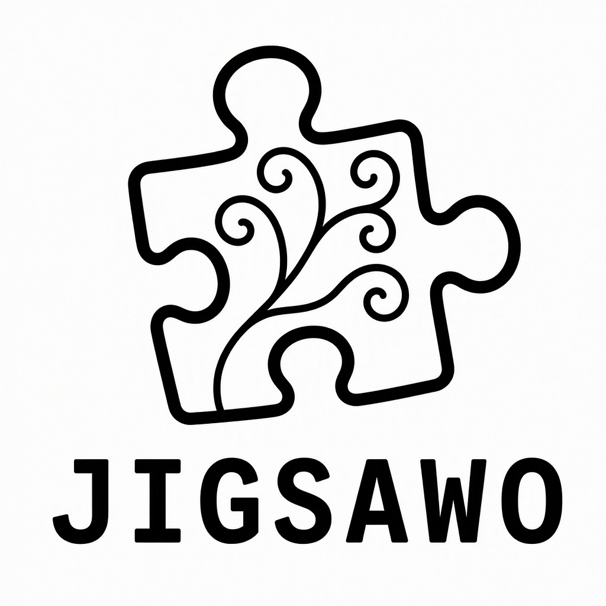

# JIGSAWO

**An entertaining offline-capable jigsaw puzzle brain game for kids and adults, using computer-generated fractals and built for web and mobile.**

[](LICENSE)


---

## About JIGSAWO

**JIGSAWO** is an offline-capable jigsaw puzzle brain game for kids and adults that uses computer-generated fractals and runs across web and mobile. By generating fractal patterns rather than depending on remote image assets or constant connectivity, every puzzle session feels fresh while staying fast and lightweight. 

### Playing JIGSAWO

Currently, one can access the game via https://jigsawo.nuchwezi.com, which also allows one to install JIGSAWO as an offline-accessible web app. However, one can also access the compartible mobile/android edition of the app --- *to come soon*.

---

## Features

- **Computer-Generated Fractals:** Procedural fractal puzzles that keep layouts fresh and engaging.
- **Offline-Capable:** Designed to run locally in the browser and offline with PWA support (`manifest.json`).
- **Web & Mobile Friendly:** Includes dedicated project directories and platform assets for `android`, `ios`, and `windows`, alongside standard web files.
- **Accessible Across Skill Levels:** Enjoyable for kids learning pattern recognition and engaging for adults looking for a mental challenge.
- **Splashscreen & App Branding:** Comes with custom icons (`favicon.ico`, `favicon-16x16.png`, `favicon-32x32.png`, `apple-touch-icon.png`, `android-chrome-192x192.png`, `android-chrome-512x512.png`), branding assets in `artworks/`, and a splashscreen flow in `index.html`.

---

## Project Structure

- `index.html` — Main game entry point, fractal puzzle logic, and splashscreen.
- `manifest.json` — Web app manifest and branding metadata.
- `artworks/` — Visual assets and promotional branding (`artworks/logo_brand.jpg`).
- `android/` — Android platform files and assets.
- `ios/` — iOS platform files and assets.
- `windows/` — Windows platform files and assets.
- `LICENSE` — GNU General Public License v3.0.

---

## Running Locally

1. Clone the repository:
   ```bash
   git clone https://github.com/mcnemesis/jigsawo.git
   cd jigsawo
